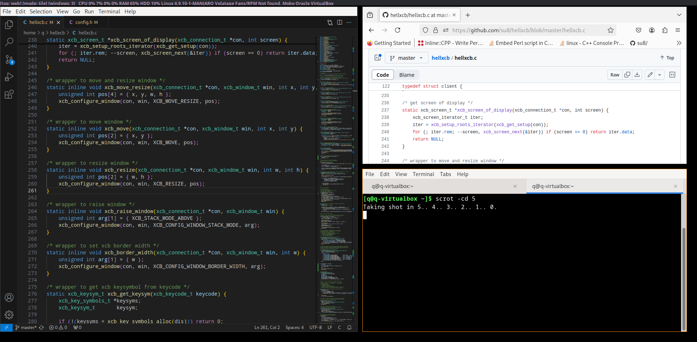

# hellxcb



Tiny(!) and monstrous! An xcb port of the [monsterwm][] tiling window manager; see its README for details.

The code editor in the picture above is Microsoft Visual Code Editor -- not **Studio Editor**

## Dependencies

A C compiler, `make`, `pkg-config` (or `pkgconf`), `libxcb` with shape and `xcb-util-keysyms`.

Debian:

```sh
apt install gcc make pkg-config libxcb-keysyms1-dev libxcb-shape0-dev
```

FreeBSD:

```sh
pkg install gmake pkgconf xcb-util-keysyms
```

NetBSD (with a full X11 desktop installed):

```sh
pkgin install gmake pkg-config xcb-util-keysyms
```

## Installation

Edit `config.h` to suit your needs, then build and install (use `gmake` on FreeBSD and NetBSD):

```sh
$EDITOR config.h
make
sudo make install    # to /usr/local; set PREFIX= for another place
```

Put these lines in `~/.xinitrc`:

```sh
#!/bin/sh
xsetroot -cursor_name left_ptr    # a mouse cursor on the desktop
picom -b                          # optional compositor, see below
while hellxcb; do :; done         # Alt+Ctrl+r restarts, Alt+Ctrl+q quits
```

Then run `startx` from the console. It starts X first, then runs `~/.xinitrc`,
so these lines fail with "unable to open display" if you type them on the console instead.
With a display manager such as xdm, put the same lines in `~/.xsession` and `chmod +x` it.

## Usage

The default bindings start `xterm` and `dmenu_run`: install them, or set `termcmd` and `menucmd` in `config.h`.
`man hellxcb` lists every binding; the basics are:

| Keys | Action |
|---|---|
| Alt+Shift+Return | start a terminal |
| Super+v, Super+right click | start dmenu |
| Alt+j / Alt+k | focus the next / previous window |
| Alt+Return | swap the window with the master |
| Alt+h / Alt+l | shrink / grow the master area |
| Alt+c | close the window |
| Alt+1..4 | go to a desktop |
| Alt+Shift+1..4 | move the window to a desktop |
| Alt+Tab | go to the last desktop |
| Alt+Shift+t / b / g / f | tile, bottom stack, grid or floating mode |
| Alt+left drag / Alt+right drag | move / resize a window, which then floats |
| Alt+b | show or hide the panel |
| Alt+Ctrl+r / Alt+Ctrl+q | restart / quit |

- **Super+z** shows and hides a drop-down terminal; the first press starts it.
  Set its command (`dropdowncmd`), `DROPDOWN_WIDTH` and `DROPDOWN_HEIGHT` (percent of the screen) in `config.h`.
  The window is found by its class or instance name `hellxcb-dropdown`, so other terminals need their own flag for it:

  ```sh
  st -c hellxcb-dropdown
  urxvt -name hellxcb-dropdown
  alacritty --class hellxcb-dropdown
  ```

- In floating mode (Alt+Shift+f), windows keep the place and size they ask for.

## Status bar

hellxcb has no bar of its own; the one in the picture above is [doomy](https://github.com/su8/doomy).
It leaves `PANEL_HEIGHT` pixels free at the top for one (`TOP_PANEL False` for the bottom).
Whenever the desktop, mode or windows change, it writes a line like this to `$XDG_RUNTIME_DIR/hellxcb.txt`
(`/tmp/hellxcb.txt` when it is not set, or the absolute path you give `HELLXCB_TAG_AND_MODE` in `config.h`):

```
[tag: 1] [mode: tile] [windows: 2] [tag 1 win: 2] [tag 2 win: 0] [tag 3 win: 1] [tag 4 win: 0]
```

Use `sed` to give the tags names:

```sh
d=${XDG_RUNTIME_DIR:-/tmp}
while true; do
  sed -E 's/tag: 1/tag: web/g; s/tag: 2/tag: dev/g; s/tag: 3/tag: misc/g; s/tag: 4/tag: float/g;
          s/tag 1/web/g; s/tag 2/dev/g; s/tag 3/misc/g; s/tag 4/float/g;' \
    "$d/hellxcb.txt" > "$d/doomy.txt.tmp"
  mv "$d/doomy.txt.tmp" "$d/doomy.txt"   # in one step, so doomy never reads it half written
  sleep 1
done &
```

## Compositor

For shadows, fading and window animations, run [picom](https://github.com/yshui/picom) (v12 or newer for animations) next to hellxcb.
Start it with `picom -b` in `~/.xinitrc`, as above. Example `~/.config/picom/picom.conf`:

```conf
backend = "glx";
vsync = true;
shadow = true;
fading = true;
fade-delta = 5;
inactive-opacity = 0.95;

animations = (
  { triggers = [ "open", "show" ];   preset = "appear";          duration = 0.2; },
  { triggers = [ "close", "hide" ];  preset = "disappear";       duration = 0.15; },
  { triggers = [ "geometry" ];       preset = "geometry-change"; duration = 0.2; },
);

rules = (
  # the drop-down terminal (Super+z) slides down from the top
  { match = "class_g = 'hellxcb-dropdown'";
    animations = (
      { triggers = [ "open", "show" ]; preset = "slide-in";  direction = "down"; duration = 0.2; },
      { triggers = [ "close", "hide" ]; preset = "slide-out"; direction = "up";   duration = 0.2; },
    );
  },
);
```

Other presets: `fly-in`/`fly-out`, and `slide-in`/`slide-out` with `direction = "left"`, `"right"`, `"up"` or `"down"`.
Wobbly windows need compiz, which is a window manager itself and cannot run next to hellxcb.

## Testing

The smoke test runs on a virtual X server and needs `Xvfb`, `xdotool`, `xterm` and `xwininfo`:

```sh
make check                          # run the smoke test
SMOKE_DISPLAY=:98 make check        # use another display
sh tests/repeat.sh 20               # run it 20 times, stop at the first failure or hang
sh tests/bench.sh ./hellxcb /path/to/other/hellxcb   # compare the speed of builds (needs gcc)
```

`bench.sh` takes `-r runs` and `-n windows`, and `BENCH_DISPLAY` picks its display.

## Thanks

[Cloudef](https://github.com/Cloudef) for [monsterwm-xcb](https://github.com/Cloudef/monsterwm-xcb),
[the suckless team][skls] for [dwm][],
[moetunes][] for [dminiwm][],
[pyknite][] for [catwm][],
[c00kiemonster][cookiemonster] for [monsterwm][],
[lasers][] for fixes and cleanups

  [skls]: http://suckless.org/
  [dwm]:  http://dwm.suckless.org/
  [moetunes]: https://github.com/moetunes
  [dminiwm]:  https://bbs.archlinux.org/viewtopic.php?id=126463
  [pyknite]: https://github.com/pyknite
  [catwm]:   https://github.com/pyknite/catwm
  [monsterwm]: https://github.com/c00kiemon5ter/monsterwm
  [cookiemonster]: https://github.com/c00kiemon5ter
  [monsterwm-xcb]: https://github.com/Cloudef/monsterwm-xcb
  [lasers]: https://github.com/lasers
