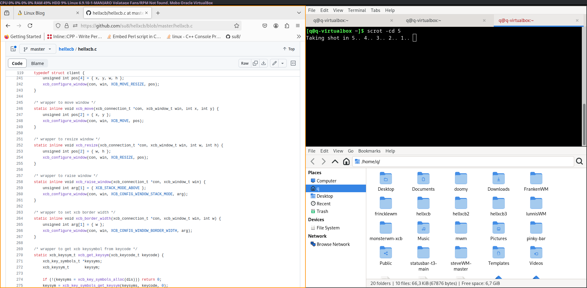

hellxcb
=============



→ tiny(!) and monsterous!
----------------------
This is xcb port of monsterwm tiling window manager.
For more detailed README refer to [monsterwm][]

The code editor in the picture above is Microsoft Visual Code Editor -- not **Studio Editor**

Installation
------------

Open up `config.h`
and edit to suit your needs.
Build and install.

    $ $EDITOR_OF_CHOICE config.h
    $ make -j8 # where 8 are CPU cores
    # make install

To have mouse cursor, open up `.xinitrc` and append somewhere before the `case` label the following `xsetroot -cursor_name left_ptr`

The statusline in the picture above is made of https://github.com/su8/doomy . You can use `sed` to make a named tag/workspace from `/tmp/hellxcb.txt` , just use `while true; do cat /tmp/hellxcb.txt | sed -E 's/tag: 1/tag: web/g; s/tag: 2/tag: dev/g; s/tag: 3/tag: misc/g; s/tag: 4/tag: float/g; s/tag 1/web/g; s/tag 2/dev/g; s/tag 3/misc/g; s/tag 4/float/g;' > /tmp/doomy.txt; sleep 1; done &` if you use https://github.com/su8/doomy

Super+z shows and hides a drop-down terminal; the first press starts it. Set its command (`dropdowncmd`), `DROPDOWN_WIDTH` and `DROPDOWN_HEIGHT` (percent of the screen) in `config.h`. The window is found by its class or instance name `hellxcb-dropdown`, so other terminals need their own flag for it, e.g. `st -c hellxcb-dropdown`, `urxvt -name hellxcb-dropdown` or `alacritty --class hellxcb-dropdown`.

Alt+Shift+f switches the desktop to floating mode: windows keep the place and size they ask for.

`make check` runs a smoke test on a virtual X server. It needs `Xvfb`, `xdotool`, `xterm` and `xwininfo`.

For shadows, fading and window animations, run [picom](https://github.com/yshui/picom) (v12 or newer for animations) next to hellxcb. Start it in `.xinitrc` with `picom -b` right after `exec hellxcb`. Example `~/.config/picom/picom.conf`:

```
backend = "glx";
vsync = true;
shadow = true;
fading = true;
fade-delta = 5;
inactive-opacity = 0.95;

animations = (
  { triggers = [ "open", "show" ];   preset = "appear";          duration = 0.2; },
  { triggers = [ "close", "hide" ];  preset = "disappear";       duration = 0.15; },
  { triggers = [ "geometry" ];       preset = "geometry-change"; duration = 0.2; },
);

rules = (
  # the drop-down terminal (Super+z) slides down from the top
  { match = "class_g = 'hellxcb-dropdown'";
    animations = (
      { triggers = [ "open", "show" ]; preset = "slide-in";  direction = "down"; duration = 0.2; },
      { triggers = [ "close", "hide" ]; preset = "slide-out"; direction = "up";   duration = 0.2; },
    );
  },
);
```

Other presets: `fly-in`/`fly-out`, and `slide-in`/`slide-out` with `direction = "left"`, `"right"`, `"up"` or `"down"`. Wobbly windows need compiz, which is a window manager itself and cannot run next to hellxcb.

The packages needed for example would be
`libxcb` `xcb-util` `xcb-util-wm` `xcb-util-keysym` `gcc` `make` `xorg` [ `pkg-config` or `pkgconfig`or `pkgconf` ]

The packages in Debian are: `libxcb-randr0` `libxcb-randr0-dev` `libxcb-ewmh` `libxcb-ewmh2` `xorg-dev` `xserver-xorg-dev` `libxcb-icccm4` `libxcb-icccm4-dev` `gcc` `make` `xorg` `pkg-config` `git` `libxcb-keysyms1` `libxcb-keysyms1-dev` `libxcb-util-wm` `libxcb-util-dev` `xcb-util` `libxcb1-deb` `libxcb-dev`

For FreeBSD the packages are `gcc` `xorg` `gmake` `chromium` `git` `gawk` `libxcb` `xcb-util` `xcb-util-wm` `xcb-util-keysyms` `pkgconf`

For NetBSD the packages are `clang` `gmake` `firefox` `git` `gawk` `xcb` `xcb-util` `xcb-util-wm` `xcb-util-keysyms` `pkg-config` and **full desktop with X11** installed on your system.

Bugs
----

I have fixed - https://github.com/Cloudef/monsterwm-xcb/issues/8 . An open dialog keeps the focus while the mouse moves over other windows, until it is closed.

Fill bugs only on hellxcb, when you are sure the bug doesn't occur on [monsterwm][].

[monsterwm issues][monsterwm-bug]

   [monsterwm-bug]: https://github.com/c00kiemon5ter/monsterwm/issues
   [monsterwm-xcb-bug]: https://github.com/Cloudef/monsterwm-xcb/issues

Thanks
------

[Cloudef](https://github.com/Cloudef) for [monsterwm-xcb](https://github.com/Cloudef/monsterwm-xcb),
[the suckless team][skls] for [dwm][],
[moetunes][] for [dminiwm][],
[pyknite][] for [catwm][],
[c00kiemonster][cookiemonster] for [monsterwm][]

  [skls]: http://suckless.org/
  [dwm]:  http://dwm.suckless.org/
  [moetunes]: https://github.com/moetunes
  [dminiwm]:  https://bbs.archlinux.org/viewtopic.php?id=126463
  [pyknite]: https://github.com/pyknite
  [catwm]:   https://github.com/pyknite/catwm
  [monsterwm]: https://github.com/c00kiemon5ter/monsterwm
  [cookiemonster]: https://github.com/c00kiemon5ter
  [monsterwm-xcb]: https://github.com/Cloudef/monsterwm-xcb
